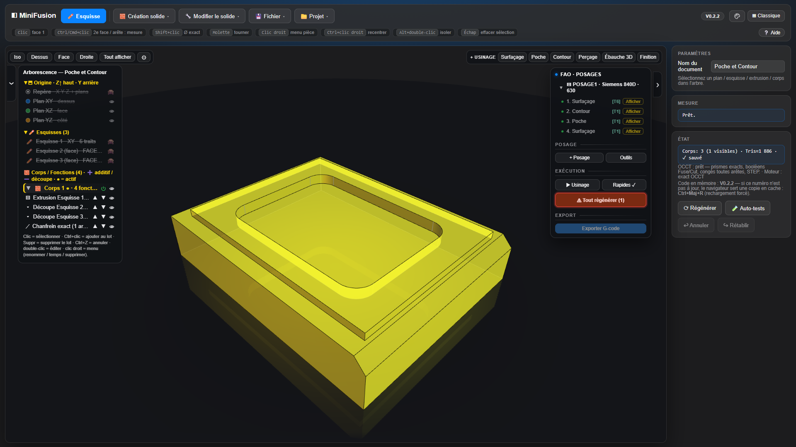

# MiniFusion

**CAO paramétrique et FAO dans un seul fichier HTML.** Esquisses contraintes, solides à historique, congés exacts, posages, parcours 2,5D / 3D, 3+2 et G-code. On ouvre la page et on travaille : il n'y a ni installation ni compte.

Le noyau géométrique exact est **OpenCascade compilé en WebAssembly**. Si le noyau n'est pas disponible, l'application bascule seule sur un moteur maillage (CSG). Version actuelle : **V0.3.18** (voir le [journal des modifications](CHANGELOG.md)).

## Deux interfaces, cinq thèmes

| Classique (l'interface historique) | Moderne (ruban, espaces CAO / FAO / PLAN, cube de vue) |
|---|---|
|  |  |

Le bouton **▦** en haut à droite bascule d'une interface à l'autre, et le bouton palette choisit le thème : **Nuit**, **Graphite**, **Atelier**, **Clair** (vue 3D claire comprise) ou **Contraste élevé**. Les deux choix sont mémorisés.


L'interface **Moderne** apporte :
- les **espaces CAO / FAO / PLAN** ;
- un **ruban à icônes** ;
- la **recherche de commandes** (`Ctrl+K`) ;
- une barre rapide : annuler, rétablir, enregistrer ;
- un navigateur **Modèle / Usinage** avec des **onglets de posages** ;
- une **barre d'état** (noyau, mesure, enregistrement, version) ;
- un **cube de vue** cliquable.

En esquisse, le bandeau d'outils remplace le ruban et le panneau des contraintes passe à droite : toute la vue sert au dessin.

## CAO


**Esquisse**
- **Outils** : ligne, rectangle (coin ou centre), oblong, cercle, arc, points de construction et de perçage, projection associative d'arêtes 3D, congé, chanfrein et décalage 2D, ajustement (trim).
- **Contraintes** (13) : horizontal, vertical, parallèle, perpendiculaire, colinéaire, égal, symétrie (y compris par rapport à une droite infinie), tangence (le côté se choisit), coaxial, milieu, fixe, coïncident, construction.
- **Solveur** : moindres carrés (Levenberg-Marquardt). Le panneau « Santé » affiche les degrés de liberté réels, et l'esquisse est colorée en bleu (sous-contrainte) ou en blanc (totalement contrainte).
- **Cotes pilotées** : longueur, Ø, rayon, distance, angle, entraxe. On peut aussi poser des cotes de référence, et les cotes R/Ø suivent la présentation d'une mise en plan.
- **Paramètres nommés** (`nom = valeur`) et **expressions ƒx** dans les cotes comme dans les champs des fonctions 3D.
- **Raccourcis** `F1`–`F12` et `H` pour les outils, plus une aide intégrée.


**Fonctions 3D** (historique rejouable, arborescence, marqueur de temps) :
- **Extrusion** : ajout ou découpe, sur une distance, jusqu'à une face ou à travers tout, en symétrique, avec une dépouille d'extrusion. Elle peut aussi créer un **nouveau corps**.
- **Révolution** autour d'une ligne de l'esquisse ou d'un axe X / Y / Z.
- **Perçage** simple, lamé, fraisé ou taraudé, débouchant ou borgne, répétable.
- **Congés et chanfreins exacts** sur les arêtes cliquées, en suivant la chaîne tangente ou sur l'arête seule. L'aperçu affiche la pièce avec les nouvelles faces en orange.
- **Modifier le solide** :
  - déplacer une face (push / pull) ;
  - dépouille (angle de démoulage) ;
  - coque ;
  - répétition linéaire, circulaire ou par symétrie (simple ou double) ;
  - **combiner** des corps : union, soustraction ou intersection.
- **Corps** : couleur, intensité, **transparence « verre »** avec arêtes cachées en filigrane, isoler, tout afficher.
- **Mesures** : face à face, Ø, entraxe, et mesure entre 2 arêtes avec `Ctrl+clic`.
- **Repère pièce** : point central, axes et 3 petits plans cliquables (esquisse dessus). Le repère et chaque plan se masquent séparément.
- **Fichiers** :
  - import STEP / STL ;
  - export STEP / STL / OBJ, y compris pour un seul corps ;
  - projet `.miniFusion` (document + parcours FAO) ;
  - sauvegarde locale automatique.

## FAO


**Posage**
- Le repère du posage est **le repère d'usinage** : son origine est le **Z0** de toutes ses opérations et du G-code.
- **Origine** : un des **27 points cardinaux** du brut ou du modèle (coins, milieux d'arêtes, centres de faces, centre). On clique le point directement dans la vue.
- **Orientation Z / X** : sur les axes de la pièce, ou par **clic sur une face ou une arête**. Si le Z du posage n'est pas celui de la pièce, tous les calculs se font dans ce repère.
- **Brut** :
  - formes : **boîte**, **cylindre** (axe X / Y / Z, Ø automatique exact) ou **modèle** (un corps est le brut) ;
  - marge XY et surépaisseurs **Z+ / Z−** ;
  - affiché en transparence quand le posage est sélectionné.
- **Réglages machine** : Siemens 840D (630 / 1520) ou Fagor 8065, origine G54–G59, plans de dégagement et de retrait, bridage, bibliothèque d'outils (cylindrique, boule, torique, forets, tarauds).


**Opérations**
- **Types** : surfaçage, poche, contour (avec attaches), perçage (cycles 81 / 82 / 83, taraudage, fraisage hélicoïdal), ébauche 3D, finition 3D (passes parallèles, géodésiques ou à crête constante).
- **Zones** : rectangle, chaîne d'arêtes du modèle ou esquisse, avec îlots. Les hauteurs se donnent par références (dessus du brut, haut ou bas du modèle, bridage, face cliquée, origine).
- **Simulation** : lecture de l'usinage, outil réel, matière enlevée au fil des passes, temps estimé.
- **Cache des parcours** : rien n'est recalculé tant que la géométrie ne change pas.


**Repère d'opération (3+2)**
- Par défaut, une opération prend le repère de son posage. Elle peut avoir **son propre Z et X**, pris sur une face ou une arête, avec un **centre commun** avec le posage.
- Elle est alors calculée dans ce repère, et le G-code oriente l'outil par **B / C** avant l'opération (Siemens `TRAORI` ; le Fagor 3 axes est signalé).
- La simulation incline l'outil et taille la matière en conséquence.

**G-code** : multi-outils, cycles du dialecte, coordonnées relatives à l'origine du posage. *Validez toujours un premier programme à vide sur la machine.*

## PLAN

**Mise en plan 2D** (espace PLAN, `src/98-mise-en-plan.js`) : la 3D reste accessible derrière l'overlay.
- **Planches** A0 à A4, portrait ou paysage, onglets renommables, cadre ISO et cartouche éditable (projet, auteur, date ; échelle et n° de planche automatiques).
- **Vues** Face, Dessus, Côté, ISO, Caméra, Auxiliaire, Coupe et Détail, par corps ou assemblées ; vues projetées du 1er angle liées à leur vue mère.
- **Arêtes** vives et tangentes du noyau exact, silhouettes de maillage pour les contours, arêtes cachées masquées (HLR de profondeur) et mode gris pointillé par vue.
- **Cotation** : diamètre, rayon, longueur, distance, angle, tolérances ISO 286, cotes de référence, format numérique français.
- **Dessin 2D** : ligne, rectangle, cercle, arc, point, ajustement, mini-solveur de contraintes et accrochages sur la géométrie projetée.
- **Sortie** : export SVG de la planche et impression. `doc.mep` est persisté avec la pièce et la FAO.

## Démarrage

```bat
Server.bat
```

`Server.bat` sert le dossier sur `http://localhost:3000`. N'importe quel serveur statique convient aussi :

```bash
npx serve . -l 3000
```

En `file://` (double-clic sur `fusion_mvp.html`), l'application démarre en mode maillage. Le bouton **⚙ Noyau .wasm…** active le noyau exact, qui est ensuite gardé en cache. Des modèles d'exemple se trouvent dans `Exemples/`.

Le dépôt stocke les gros binaires (`occt/*.wasm`, `Exemples/*.miniFusion`, `Exemples/*.step`) via **Git LFS**. Après un clone : `git lfs install` puis `git lfs pull`.

## Développement

| Chemin | Rôle |
|---|---|
| `src/*.js` | **Les sources** (49 fichiers, de l'en-tête à l'initialisation ; la FAO est découpée par domaine : parcours, caches, post-processeurs, simulation, interface, ébauche 3D, contour). C'est ici qu'on travaille. |
| `fusion_mvp.html` | **Livrable généré** par `node build.js`. On ne l'édite jamais à la main. |
| `tests/` | Suite Node portable (105 suites, dont certaines sur le noyau OCCT réel) : `node tests/run.cjs` ; sous-ensemble CI : `node tests/run-fast.cjs`. |
| `tools/lint.cjs` | Lint ESLint du script concaténé (même ordre que le build) : `npm run lint` (erreurs) ou `npm run lint:all` (avertissements inclus). |
| `.github/workflows/ci.yml` | CI : build à jour, syntaxe, tests rapides, lint. |
| `CHANGELOG.md` | Une entrée par version : cause, correctif, test. |
| `occt/`, `threejs/` | Noyau OpenCascade WebAssembly, rendu three.js (stockés via Git LFS pour les `.wasm`). |
| `PostPro/` | Post-processeurs de référence (Siemens 840D, Fagor 8065). |
| `Backup/` | Un instantané par version (non versionné). |

Cycle de livraison :
1. modifier `src/` ;
2. `node build.js` ;
3. `node tests/run.cjs`, qui doit être entièrement vert (ou `npm run test:fast` en cours de travail) ;
4. `npm run lint` ;
5. incrémenter `APP_VER` dans `src/00-entete-et-outils.js` et ajouter une entrée au CHANGELOG ;
6. `node build.js --check` ;
7. copier l'instantané dans `Backup/fusion_mvp_V0.x.y.html` ;
8. commit, push et tag `V0.x.y`.

**Un seul numéro de version**, celui des tags Git.

## Licences

- Code : **ISC** (voir `package.json`).
- `threejs/` : three.js et OrbitControls sous **MIT**, CSG.js.
- `occt/` : OpenCascade Technology sous **LGPL**.
