# MiniFusion

**CAO paramétrique, assemblage, FAO et mise en plan dans un seul fichier HTML.** Esquisses contraintes, solides à historique, congés exacts, posages, parcours 2,5D / 3D, 3+2, G-code et planches cotées ISO. On ouvre la page et on travaille : il n'y a ni installation ni compte.

Le noyau géométrique exact est **OpenCascade compilé en WebAssembly**. Si le noyau n'est pas disponible, l'application bascule seule sur un moteur maillage (CSG). Version actuelle : **V0.9.2** (voir le [journal des modifications](CHANGELOG.md)).

## Sommaire

- [Interface](#interface)
- [CAO](#cao) : esquisse, fonctions 3D, corps, mesures, fichiers
- [Composants](#composants) : composants imbriqués, occurrences, placement par repères
- [FAO](#fao) : posage, brut, opérations, simulation, 3+2, G-code
- [PLAN](#plan) : planches, vues, coupes, cotation, sorties
- [Souris et clavier](#souris-et-clavier)
- [Démarrage](#démarrage) · [Développement](#développement) · [Licences](#licences)

## Interface

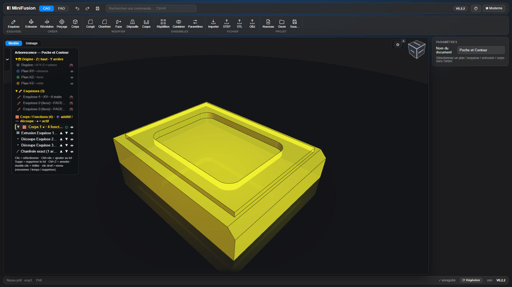

Une seule interface, organisée en **trois espaces** : **CAO**, **FAO** et **PLAN**.
- **Bandeau supérieur** : espaces CAO / FAO / PLAN, barre rapide (annuler, rétablir, fichiers), **recherche de commandes** (`Ctrl+K`), puis l'**état** — noyau, message en cours (texte complet au survol), **Régénérer**, unité —, le nom du document (● = non enregistré) et la version. Au premier lancement, le bouton **Noyau .wasm…** y active le noyau exact. Sur un écran étroit, l'état passe sur une 2ᵉ ligne du bandeau.
- **Ruban à icônes** propre à chaque espace, sous le bandeau.
- **Navigateur Modèle / Usinage** avec des **onglets de posages**, et panneau de propriétés à droite. Pas de barre en bas : la **vue 3D descend jusqu'en bas** de la fenêtre.
- **Fenêtres de fonctions à icônes** (extrusion pour commencer) : les choix (opération, direction, étendue) en boutons à icône plutôt qu'en listes, les réglages rares dans « ▸ Options », **Annuler / OK**.
- **Cinq thèmes** (bouton palette) : **Nuit**, **Graphite**, **Atelier**, **Clair** (vue 3D claire comprise) et **Contraste élevé**. Le choix est mémorisé.

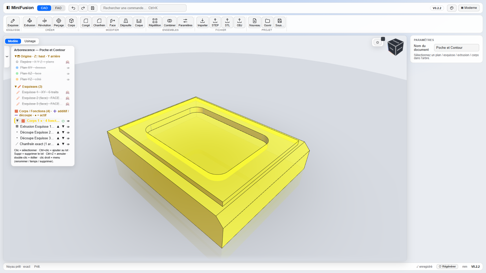

**Vue 3D**
- **Cube de vue** cliquable (faces, ⌂ = vue iso complète) et vues Dessus / Face / Droite / Iso.
- **Orbite contrainte** (Z en haut) ou **orbite libre** dans tous les sens, au choix par le bouton ⟲ du cube ; le **centre de rotation** est la face sélectionnée, sinon le centre des pièces visibles (en mode Placer : la pièce sélectionnée ou le repère cliqué dans l'arbre).
- **Sol miroir** sous la dernière pièce visible (composants autour de la pièce compris ; sous le brut en FAO, simulation comprise). En FAO, le haut de la vue est le Z du posage ou de l'opération.
- **Transparence « verre »** : une pièce transparente montre son intérieur, mais jamais à travers une pièce opaque qui la cache.

## CAO

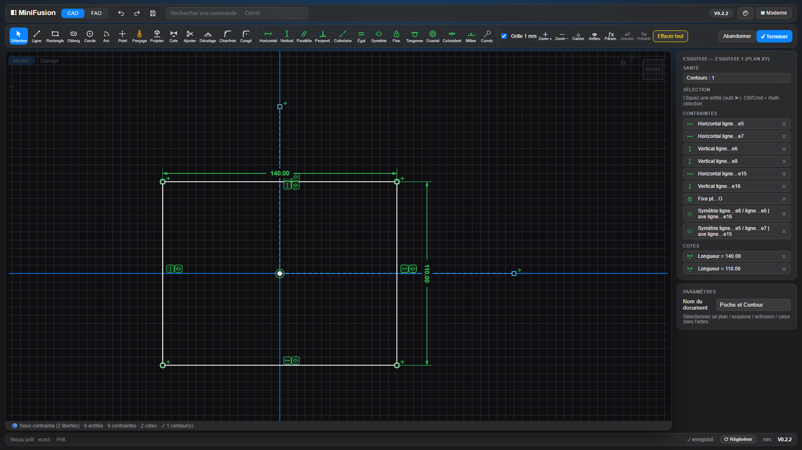

### Esquisse

**Vue d'esquisse, façon Fusion 360**
- À l'ouverture, l'esquisse se met **à plat**, face choisie **devant et à l'endroit** (le Z du monde en haut). Si on décoche la case **« À plat »**, la **vue 3D courante est gardée** : on dessine sur le plan sans quitter son point de vue, et la vue reste orientée ainsi à la sortie.
- **Orbite** pendant le dessin : **clic-molette glissé**, cube de vue, ou bouton **⟳** (vue inclinée ↔ à plat). La touche **N** remet la vue à plat dans le plan de l'esquisse. Le tracé, l'accrochage, le zoom et le déplacement restent exacts sur le plan sous tous les angles, et les cotes restent lisibles.
- La **pièce est affichée en transparence** : faces légèrement teintées, toutes les arêtes tracées comme en 3D (gris clair devant, gris plus sombre derrière). Pour une esquisse consommée par une fonction, c'est l'état de la pièce **avant** cette fonction.
- **Grille** affichable ou masquée (bouton **▦**, masquée par défaut, choix mémorisé) ; les axes de l'origine restent toujours visibles. L'accroche au pas (« Grille 1 mm ») marche dans les deux cas.
- **Bandeau Esquisse** sans boutons en double : le zoom se fait à la molette ; pendant une esquisse, les flèches ↩ ↪ du bandeau supérieur (et `Ctrl+Z` / `Ctrl+Y`) annulent et rétablissent les **tracés**.
- Une esquisse posée sur une face verticale a son axe vertical vers le haut : elle ne s'ouvre plus à l'envers.

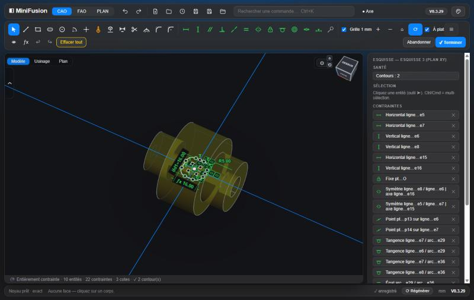

**Dessin et contraintes**
- **Outils** : ligne, rectangle (coin ou centre), oblong, cercle, arc, points de construction et de perçage, **projection associative** d'arêtes 3D, congé, chanfrein et décalage 2D, ajustement (trim).
- **Contraintes** (13) : horizontal, vertical, parallèle, perpendiculaire, colinéaire, égal, symétrie (y compris par rapport à une droite infinie), tangence (le côté se choisit), coaxial, milieu, fixe, coïncident, construction.
- **Solveur** : moindres carrés (Levenberg-Marquardt) au **moindre déplacement** : le reste de l'esquisse bouge le moins possible, un point tenu sur une courbe glisse. Un **glisser avance par petits pas**, chacun résolu depuis le précédent, sans sauter vers la solution symétrique ; au bord de ce que la géométrie peut atteindre, elle s'arrête. Une **cote ou une contrainte impossible est refusée** : l'esquisse reste telle quelle et la barre d'état dit pourquoi. Le panneau « Santé » affiche les degrés de liberté réels ; l'esquisse est bleue (sous-contrainte) ou blanche (totalement contrainte).
- **Cotes pilotées** : longueur, Ø, rayon, distance, angle, entraxe ; cotes de référence ; saisie dynamique de la longueur et de l'angle pendant le tracé.
- **Paramètres nommés** (`nom = valeur`) et **expressions ƒx**, dans les cotes comme dans les champs des fonctions 3D.
- **Configurations** (fenêtre ƒx) : une table de variantes — une colonne par valeur nommée, une ligne par variante (valeurs ou expressions, fonctions supprimées). Le sélecteur en tête de l'arbre active une variante : valeurs écrites, fonctions supprimées / rétablies, régénération, une étape d'annulation. « Mémoriser l'état actuel » remplit la variante active.
- **Raccourcis** `F1`–`F12` (contraintes), `H` (centre de perçage), `L` `C` `R` `B` `P` `T` `D` `F` `O` (outils), `X` (construction), `N` (à plat), plus une aide intégrée.

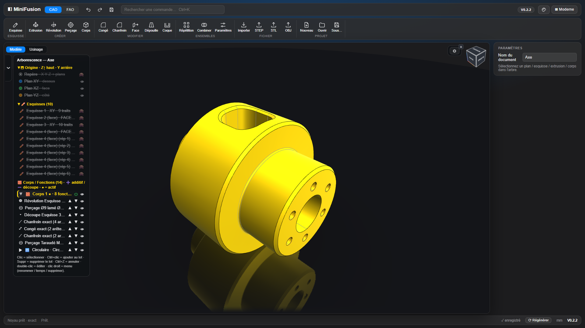

### Géométrie de construction

Groupe **Construire** du ruban (et `Ctrl+K`) : des références à la manière de Fusion 360, rangées dans le groupe **📐 Construction** de l'arborescence et placées dans le fil des fonctions.
- **Plans** : décalé, à un angle autour d'un axe, par 3 points, médian entre deux plans parallèles, normal à un axe.
- **Axes** : sur une arête droite, une face cylindrique ou conique, un axe ; par 2 points ; intersection de 2 plans ; normal à un plan.
- **Points** : sommet, centre d'une arête circulaire, point d'esquisse ; coordonnées dans un repère ; intersection axe / plan.
- **Repères** : origine + direction Z + direction X, sur un plan ou une face, ou par 3 points ; décalages et rotation autour de Z.
- Les références se désignent **dans la vue** (faces, arêtes, sommets, éléments de construction) **ou dans l'arbre** (plans et axes X / Y / Z de l'origine). Valeurs en **ƒx**, aperçu en direct, ✓ pour valider.
- **Esquisse dessus** : double-clic sur un plan (ou un plan de repère) dans l'arbre, ou bouton Esquisse. L'esquisse suit le plan quand il bouge.
- **Associatif** : un plan posé sur une face suit la pièce quand une cote change. Si une référence disparaît, ou sans noyau exact, l'élément garde sa dernière position et affiche ⚠.

### Fonctions 3D

Historique rejouable, arborescence et marqueur de temps. **Bandeau de timeline** en bas de la vue 3D, à la manière de Fusion 360 : une étape par fonction, esquisse ou élément de construction, avec **l'icône de la commande du ruban** qui l'a créée — **vert** pour un ajout de matière, **rouge avec « − »** pour un enlèvement ; clic = sélection, double-clic = édition, marqueur temps glissable (⏮ ◀ ▶ ⏭), glisser-déposer d'une fonction pour la réordonner dans son corps.
- **Extrusion dynamique** : ajout ou découpe, sur une distance, jusqu'à une face ou à travers tout, en symétrique, avec dépouille ; elle peut créer un **nouveau corps**. Elle **apparaît tout de suite** (l'aperçu est le résultat) ; une **flèche se tire dans la vue** (pas de 1 mm, Maj = libre, de l'autre côté du plan = sens inversé) et un champ **« Distance »** flotte à côté. La fenêtre présente opération, direction et étendue en **boutons à icônes**, la dépouille dans « ▸ Options », **Annuler / OK** (Échap annule). Sélectionner une extrusion rouvre la même fenêtre pour la modifier.
- **Révolution** autour d'une ligne de l'esquisse ou d'un axe X / Y / Z, en **fenêtre dynamique** comme l'extrusion : elle apparaît tout de suite, une **poignée d'angle** tourne autour de l'axe dans la vue, Annuler / OK.
- **Perçage** simple, lamé, fraisé ou taraudé (filet ISO réellement modélisé), débouchant ou borgne, répétable ; type et fin en **boutons à icônes**, **flèche de profondeur** dans la vue (trou borgne), Annuler / OK.
- **Congés et chanfreins exacts** sur les arêtes cliquées, en suivant la chaîne tangente ou sur l'arête seule ; aperçu avec les nouvelles faces en orange ; **flèche de rayon** dans la vue et champ « Rayon (toutes) », Annuler / OK.
- **Répétition** : linéaire, à **une ou deux directions (grille)**, circulaire, symétrie simple ou double. Chaque direction se règle sur X / Y / Z ou sur la sélection de la vue avec **🎯**, sur la ligne de son axe — **arête** droite (sa direction), **cercle ou arc** (son axe) ou **face** (sa normale) — et **⇄** l'inverse.
- **Modifier le solide** : déplacer une face (push / pull), **supprimer une face** (`Suppr`, les voisines se prolongent : congé → arête vive, trou rebouché), dépouille, coque, **combiner** des corps (union, soustraction, intersection).

### Corps, mesures, fichiers

- **Corps** : couleur, intensité, **transparence « verre »** avec arêtes cachées en filigrane, isoler, tout afficher.
- **Mesures** : face à face, Ø, entraxe, et mesure entre 2 arêtes avec `Ctrl+clic`.
- **Repère pièce** : point central, axes et 3 petits plans cliquables (esquisse dessus) ; chaque élément se masque séparément.
- **Fichiers** : import STEP / STL ; export STEP / STL / OBJ (aussi pour un seul corps) ; projet **`.miniFusion`** (document, parcours FAO, planches) ; sauvegarde locale automatique.
- **Enregistrement sûr** : le contenu est contrôlé avant d'écrire (un enregistrement raté ne remplace jamais un bon fichier), l'écriture est abandonnée en cas d'erreur, et la **version précédente** est gardée : `nom.miniFusion.bak` à côté du fichier quand il est dans le dossier de projets, et toujours dans le navigateur. Menu Projet → **Copie de secours…** pour la rouvrir (Ctrl+S la remet dans le fichier).

## Composants

Comme dans Fusion 360, **tout est composant**. Le fichier est le **composant racine** : une pièce complète (esquisses, construction, corps, FAO, PLAN) qui peut porter des **composants enfants**, eux-mêmes pièces complètes avec leurs propres enfants, à n'importe quelle profondeur. Un fichier sans composant reste exactement comme avant ; un assemblage de V0.6.0 s'ouvre tel quel (ses pièces deviennent des composants d'une racine vide).

Deux modes pour le composant actif (groupe **Composants** du ruban) :
- **Modéliser** : on l'édite comme une pièce seule (CAO, FAO, PLAN) ; le reste de l'assemblage est affiché autour **comme en mode Placer** (arêtes, intensité, transparence), non sélectionnable ;
- **Placer** : on déplace ses composants enfants (clic n'importe où sur un enfant = le sélectionner).

Navigation :
- **double-clic** sur un composant (vue ou arbre) : on le modélise ;
- **fil d'Ariane** « 🧩 Racine › Châssis › Roue » en tête de l'arbre (la racine porte le nom du fichier) : un clic remonte à ce niveau **dans le mode en cours** ; ses boutons **✏️ Modéliser** et **🧩 Placer** changent de mode sans quitter la pièce (Placer depuis une pièce sans sous-composants : l'assemblage qui la contient, elle sélectionnée) ; **Échap** en mode Placer (rien de sélectionné) remonte d'un niveau ;
- section **Composants** de l'arbre : toute la hiérarchie, double-clic pour aller n'importe où.

Commandes :
- **Composant** : nouveau composant dans le composant actif, on entre aussitôt dedans ;
- **Occurrence** : le même composant, une fois de plus ;
- **Insérer** : copie un autre fichier `.miniFusion` comme composant du composant actif (sa racine avec sa géométrie, ses sous-composants imbriqués) ;
- **placer** : manipulateur (flèches = déplacer, anneaux = tourner, pas de 1 mm et de 5°, Maj = libre), panneau (position X / Y / Z, rotations de ±90°) ;
- **Rotation de la vue en mode Placer**, comme en Modéliser : autour de l'occurrence sélectionnée, ou du repère de référence cliqué dans l'arbre (origine du composant, repère de construction ; clic à nouveau ou Échap pour revenir), sinon autour du centre des pièces placées ;
- **Apparence en mode Placer** : les arêtes s'affichent comme en Modéliser (bouton « Arêtes »). Chaque occurrence a ses propres réglages, ceux d'un corps — « Intensité », « Transparence » (même rendu verre : perçages et arêtes cachées visibles) — et ses arêtes ; la couleur reste celle des corps, la même partout (comme le bouton, toujours, jamais) ; valables pour tout ce qu'elle contient, la même en mode Modéliser pour les composants affichés autour de la pièce, « Appliquer à toutes les occurrences » ;
- **Aligner un repère** : un repère du composant (son origine, un repère de construction, le sien ou celui d'un sous-composant) posé sur un repère du composant actif (sa **géométrie de base** : origine, repères de construction) ou d'un autre de ses composants, à toute profondeur, avec retournement, rotation et décalage. **Points d'accroche** : au lieu d'un repère, on clique une face d'un composant et on choisit un point de sa géométrie — centre et points cardinaux d'une face plane (nord, sud, est, ouest, coins), début, milieu ou fin de l'axe d'un cylindre, centre d'un cercle ou d'un arc, milieu ou extrémités d'une arête ; Z suit la normale de la face ou l'axe. **Associatif** : si un composant change, son repère ou sa face bouge et les composants alignés suivent (face disparue : ⚠, position gardée) ;
- **Fixer** (📌), **masquer**, **renommer**, **supprimer** (la dernière occurrence emporte son composant). Ctrl+Z / Ctrl+Y annulent les opérations de placement en mode Placer.

Convertir une pièce multicorps en assemblage, sans rien remodéliser :
- **Depuis corps** (ruban), ou clic droit sur un corps → **Créer un composant depuis ce corps** : le corps et tout ce qui le construit (ses fonctions, les esquisses et la construction dont elles dépendent, les paramètres) passent dans un composant neuf, à la même place, avec sa couleur. Sans corps sélectionné, « Depuis corps » convertit chaque corps ;
- clic droit sur un corps ou une esquisse → **Déplacer vers un composant…** : vers un composant existant, ou neuf ;
- une esquisse ou une construction utilisée aussi par ce qui reste est **copiée**, sinon **déplacée**. L'opération est **refusée, avec la raison**, quand ce qui part s'appuie sur ce qui reste (esquisse posée sur une face d'un autre corps, combinaison entre corps) ou l'inverse ;
- une seule étape d'annulation : Ctrl+Z en mode Modéliser la défait entièrement.

**Composants liés** (Chrome / Edge) : un composant peut venir d'un autre fichier `.miniFusion` et rester LIÉ à lui.
- **Insérer** propose **Lier** (recommandé) ou **Copier**. Un fichier du **dossier de projets** est retrouvé par son chemin, sur n'importe quel PC qui synchronise ce dossier (Dropbox) ; hors du dossier, le lien ne vaut que sur cet ordinateur. Le fichier hôte garde une copie : il s'ouvre même sans la source (⚠).
- **Édition sur place** : on modélise un composant lié comme un autre (✎ dans l'arbre) ; à l'enregistrement de l'assemblage (Ctrl+S), sa source est réécrite d'abord (trajectoires FAO de la source gardées).
- **Mise à jour** : à l'ouverture, au retour sur l'onglet et par 🔄 dans l'arbre (le premier clic autorise l'accès au dossier) : une source changée ailleurs est rechargée, les alignements suivent. Modifiée des deux côtés : **Garder les miennes**, **Prendre la source** ou **Rompre le lien**.
**Mise en plan d'assemblage** (espace PLAN du composant actif) :
- une vue peut montrer **🧩 Assemblage (avec les composants)** (liste « Corps » de la vue) : le composant et toutes ses instances, en lignes cachées exactes (HLR OCCT), coupes et détails compris ; elle suit les placements ;
- **nomenclature** par composant : corps du composant (comme avant), composants du 1er niveau, de tous les niveaux, ou pièces seules ; quantités, dimensions, matière (celle du composant, ou saisie au plan) ;
- **bulles automatiques** sur la première vue d'assemblage : numérotées comme la nomenclature, et renumérotées avec elle. Chaque bulle s'accroche sur une partie **visible** de sa pièce et se range autour de la vue, sans que son trait passe au-dessus d'une autre pièce ni sur le titre de la vue. Une bulle **se glisse**, `Suppr` la retire, **＋ Bulle** en pose une sur la pièce cliquée.
- **Coupes d'assemblage** : les vues dérivées (coupe, projetée, détail, auxiliaire) d'une vue « Assemblage » montrent l'assemblage ; **une hachure par pièce** (45° / 135°, puis pas différent), réglable dans la fenêtre des hachures.

**Inspecter** (ruban Composants, noyau exact) : sur le composant actif et tout ce qu'il contient — ou sur une pièce multicorps seule.
- **Propriétés physiques** : volume, masse et centre de gravité par corps et au total (sphère jaune) ; la **matière** se choisit par composant (acier par défaut, inox, aluminium, laiton, bronze, cuivre, fonte, titane, PLA, ABS, PETG, nylon, POM, chêne).
- **Interférences** : volume commun entre deux corps (même pièce ou composants différents), en rouge dans la vue, avec son volume.
- Formes exactes gardées en cache tant qu'un composant ne change pas : relancer est immédiat.

**Liaisons mécaniques** : un alignement devient une liaison en choisissant son type dans le panneau — **Rigide** (l'alignement), **Pivot** (rotation autour de Z du repère de liaison), **Glissière** (le long de Z), **Pivot glissant**, **Plan** (X, Y et rotation Z), **Rotule**.
- Chaque degré de liberté a son **curseur** (valeur, limites min / max) ; le **manipulateur** ne propose que ces mouvements (anneau pour une rotation, flèche pour une translation), dans les limites.
- **Liaison telle que construite** : à la position actuelle, autour d'un axe de l'occurrence, sans choisir de repères — rien ne bouge à la création.
- **Capturer la position** (position de repos) / **Rétablir**, **▶ Animer** entre les limites (Échap arrête). Sans occurrence sélectionnée, le panneau **pilote toutes les liaisons** du composant.
- Résolution directe dans l'ordre des dépendances (chaque occurrence a au plus une liaison) : une boucle fermée donne ⚠.

**Références entre composants** : dans un composant, un plan, un axe, un point ou un repère de construction peut reprendre un élément d'un AUTRE composant (méthode **Depuis un autre composant** : un de ses plans, axes, points ou repères de construction, ou de son origine). On y pose une esquisse, on extrude jusqu'à lui, on aligne dessus… comme sur un élément du composant.
- **Associatif** : si l'autre composant change ou se déplace, l'élément suit, et le composant est rejoué (même inactif) ; **Figer** l'arrête à sa position.
- La référence est prise **en contexte** : depuis l'instance où l'on travaille (un composant présent deux fois garde la position vue depuis la première).
- Élément visé supprimé : position gardée, ⚠ ; références circulaires (un placement qui dépend d'une référence qui dépend de ce placement) : ⚠ après trois passes.
- **Arêtes des autres composants dans une esquisse** : l'outil **Projeter** de l'esquisse propose aussi les arêtes exactes des autres composants de l'assemblage (lignes, arcs, cercles), vues depuis l'instance où l'on travaille. L'arête projetée **suit** quand l'autre composant se déplace ou change (même inactif), comme une projection d'arête de la pièce.

- Clic droit sur un composant : **Extraire vers un fichier…** (il devient lié à ce fichier), **Remplacer par un lien…**, **Relier la source…** (fichier déplacé ou renommé), **Rompre le lien** (copie locale), **Mettre à jour les liens**. Lier deux fois la même source donne une nouvelle occurrence.

## FAO

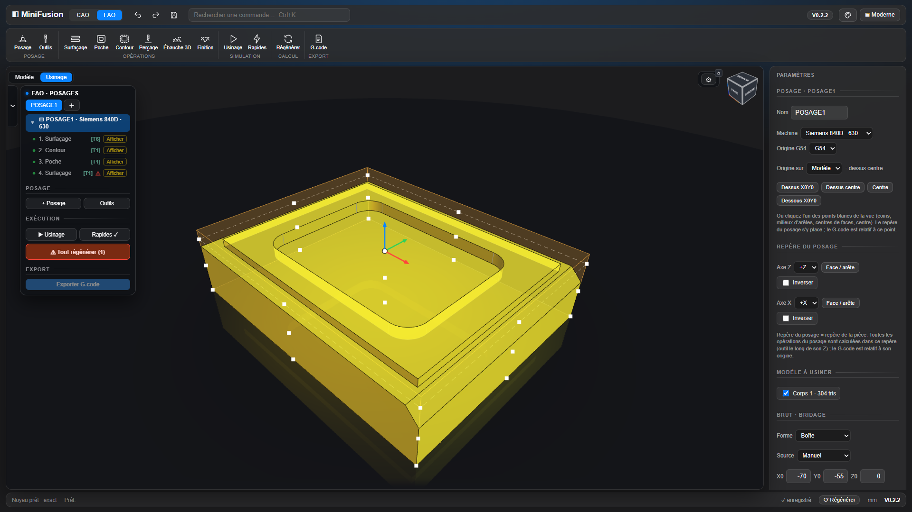

### Posage et brut

- Le repère du posage est **le repère d'usinage** : son origine est le **Z0** de toutes ses opérations et du G-code. Tous les calculs se font dans ce repère.
- **Origine** : un des **27 points cardinaux** du brut ou du modèle, cliqué dans la vue. **Orientation Z / X** sur les axes de la pièce, par clic sur une face ou une arête, ou par **rotation autour de X**.
- **Brut** : **boîte**, **cylindre** (axe X / Y / Z, Ø exact) ou **corps réel** (un corps du modèle sert de brut, il est usiné et simulé tel quel) ; marge XY et surépaisseurs Z+ / Z− ; affiché en transparence quand le posage est sélectionné.
- **Fiche posage en onglets** : Général, Repère, Modèle, Brut, Plans, Temps.
- **Réglages machine** : Siemens 840D (630 / 1520) ou Fagor 8065, origine G54–G59, plans de dégagement et de retrait, bridage.
- **Outils** : fraises cylindriques, boules, toriques, forets et forets à pointer (pointe réelle), **foret à centrer DIN 333 A**, tarauds.

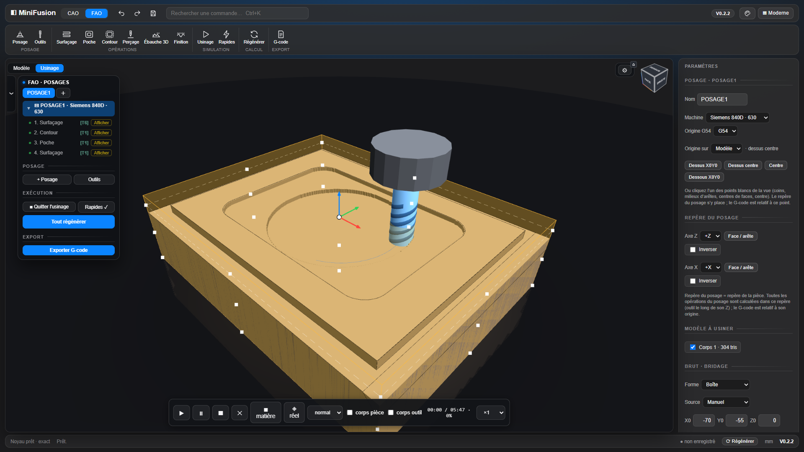

### Opérations

- **Surfaçage**, **Chanfrein** (arêtes cliquées, largeur, décalage de pointe ; fraise à chanfreiner ou foret à pointer — la Poche des anciens fichiers reste calculée), **Contour** (avec attaches), **Perçage** (cycles 81 / 82 / 83, débourrage, brise-copeaux, taraudage, fraisage hélicoïdal, pointage).
- **Ébauche 3D** : niveaux en Z, minipasses entre les niveaux, fond plat hors grille usiné par une passe limitée à l'épaulement, entrées par l'extérieur quand l'air est à portée, sinon en hélice ; option **« Finir une région avant l'autre »** ; calcul sur un maillage précis (0,05 mm) du solide exact.
- **Finition** (passes parallèles ou à crête constante) et **Géodésique** (passes à distance constante sur les faces choisies, depuis leurs bords, rejointes en glissant au contact).
- **Faces usinables (bleu) / intouchables (rouge)** par opération, avec marge et **« Interdire devant la face »** : la fraise ne descend jamais le long d'un flanc rouge.
- **Zones** : rectangle, chaîne d'arêtes du modèle ou esquisse, avec îlots ; hauteurs par références (dessus du brut, haut ou bas du modèle, bridage, face cliquée, origine).
- **Simulation** : outil réel, matière enlevée au fil des passes à partir du vrai brut, rendu réel ou lisse, temps estimé. La matière est éclairée d'après la **forme de l'outil** (fond, arrondi, pointe, parois) et dessinée par la **carte graphique** (maille de 0,2 mm). En 3+2, chaque orientation d'outil a sa **carte de hauteurs** et la matière est rendue par **lancer de rayons** : les cavités latérales sont aussi nettes que le dessus.
- **Moteur de simulation** (barre de lecture) : **cartes** (défaut, ci-dessus) ou **distance** (champ de distance signée, surfaces lisses sans marches, arêtes légèrement adoucies). Mêmes outils, mêmes parcours ; le choix est mémorisé. Les deux **taillent et affichent sur la carte graphique** : cartes de hauteurs taillées par un test de profondeur, champ de distance taillé dans une texture 3D et affiché par lancer de rayons. Sans WebGL2, la taille repasse en JavaScript.
- **Cache des parcours** : rien n'est recalculé tant que la géométrie ne change pas.

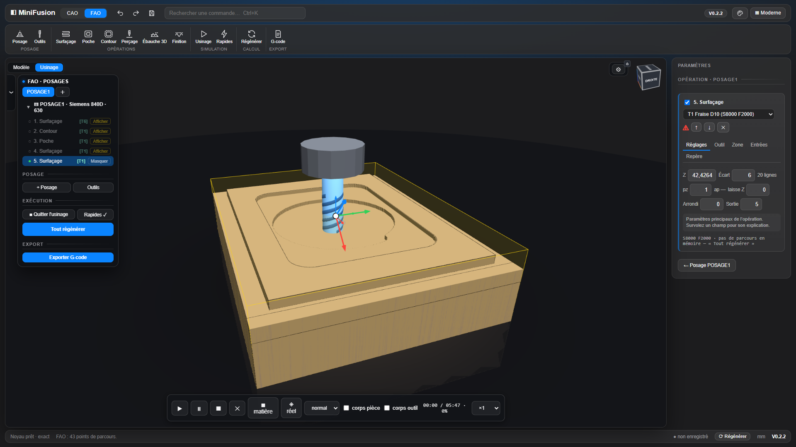

### Repère d'opération (3+2) et G-code

- Une opération peut avoir **son propre Z et X**, pris sur une face ou une arête, avec un **centre commun** avec le posage. Elle est calculée dans ce repère. Sur Siemens, le G-code **pivote le plan de travail par `CYCLE800`** (jeu « TABLE », mode 27, comme les posts Fusion de la 630 et de la 1520) après le dégagement de la machine, puis écrit X Y Z **dans le plan incliné** : arcs G2/G3 et cycles de perçage sont gardés ; la table est remise à plat en fin de programme. Réglage `swivel: 'traori'` dans la fiche machine pour l'ancienne sortie `TRAORI` + B / C. Le Fagor 3 axes est signalé. La simulation incline l'outil.
- **G-code** multi-outils, cycles du dialecte, coordonnées relatives à l'origine du posage, **avance F modale** (écrite seulement quand elle change). *Validez toujours un premier programme à vide sur la machine.*

## PLAN

**Mise en plan 2D** : les planches sont enregistrées avec la pièce et la FAO, et suivent le modèle.

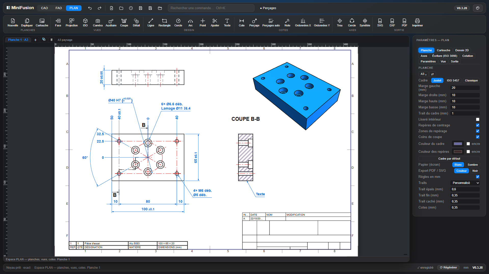

### Planches

- **Formats** A4 à A0 en paysage (H) ou portrait (V), ou **format manuel** en mm ; plusieurs planches en onglets (nouvelle, dupliquer).
- **Cadre** réglable : marges, traits, couleurs, zones de repérage, repères de centrage ; préréglages **Justet**, **ISO 5457**, Classique.
- **Cartouche** éditable (esquisse contrainte, champs matière, TTS, TTH…), export / import `.mfcartouche` ; **nomenclature** et **tableau des révisions**.
- **Écriture ISO 3098** : hauteurs des cotes, des repères et des textes.
- **Paramètres du plan** enregistrés par projet, export / import `.mfplan`. Panneau en onglets : Planche, Cartouche, Dessin 2D, Axes, Cotation, Vue, Sortie.

### Vues

- **Types** : Face, Projection (1er angle, liée à sa vue mère), ISO, Caméra (depuis la 3D), Auxiliaire, **Coupe** et **Détail**, par corps ou en assemblage.
- **Arêtes exactes** du noyau (HLR OCCT), y compris pour un STEP importé ; cachées supprimées ou en pointillé, tangentes au choix ; ombrage ou rendu 3D.
- **Projection** : orthogonale, **perspective** comme la vue 3D (la « fuyante » règle l'angle de champ) ou **cavalière** (angle et coefficient des fuyantes).
- **Ligne de coupe** droite ou **brisée** (ISO 128-44), liée aux perçages, traits d'axe et arêtes (elle suit le trou) ; on tire un tronçon pour le déplacer, **Ctrl + clic** ajoute une brisure, **Maj + clic** l'enlève.
- **Hachures** (ISO 128-50) : double-clic → motif, angle, échelle, couleur, pour toutes les coupes.
- **Filetages** (ISO 6410) des perçages taraudés : 3/4 de cercle en bout, fond de filet et fin de filetage en coupe.
- **Axes** (ISO 128-2) : trou, alignement, cercle de perçage, cylindres d'un STEP, **symétrie** entre deux droites (associatif) ; ils s'étirent, s'accrochent et se cotent.

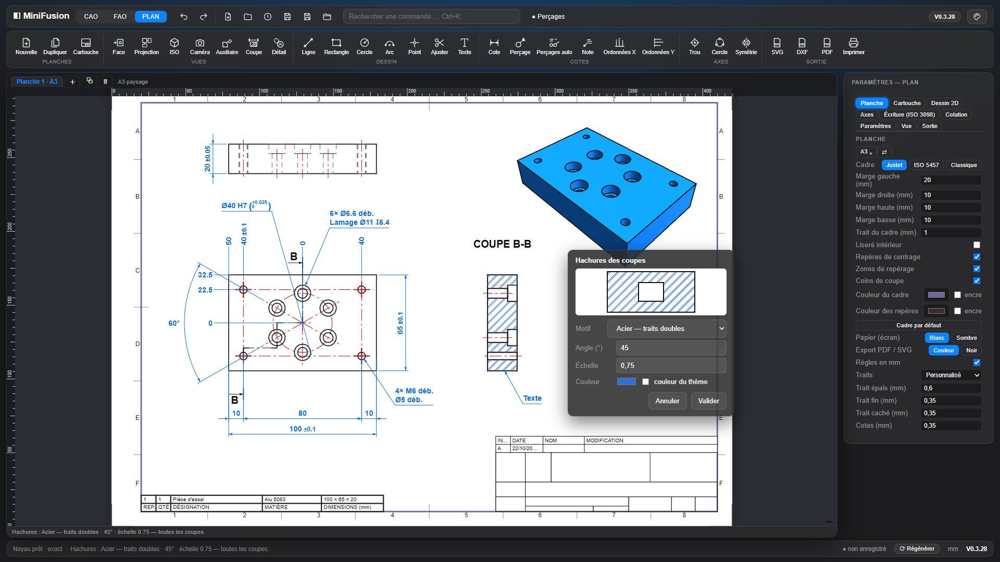

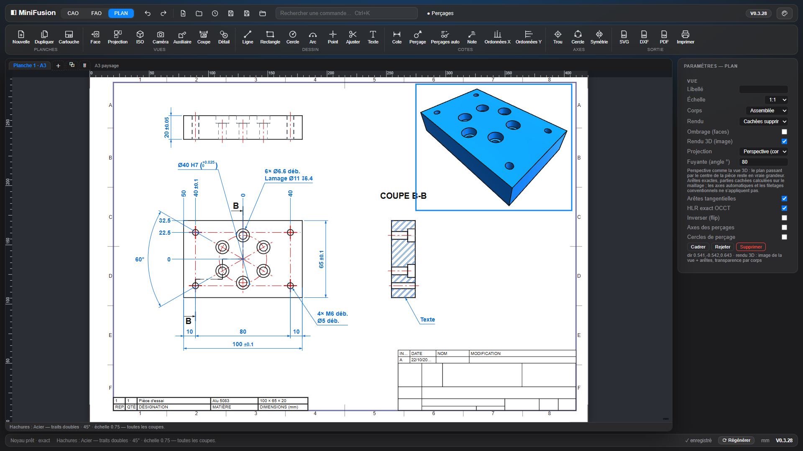

### Cotation

- **Cote** (outil unique) : longueur, distance, Ø, rayon, angle. On tire une cote le long de ses lignes de rappel et sa valeur le long de la ligne ; double-clic = sens des flèches. Les cotes accrochées à un axe ou à une arête **suivent** quand la pièce change.
- **Tolérances** : ± symétrique, double, **classe ISO 286** avec ses écarts (`Ø40 H7 (+0,025 / 0)`) ; cotes de référence.
- **Perçages** : étiquette depuis la fonction Perçage (Ø, lamage, fraisure, taraudage, n×), avec tolérance ; « Perçages auto » cote toute la planche.
- **Ordonnées X / Y** : une origine « 0 », des valeurs alignées qui se déplacent ensemble, une tolérance par valeur.
- **Notes** à flèche et **alignement** de cotes sur une cote de référence.

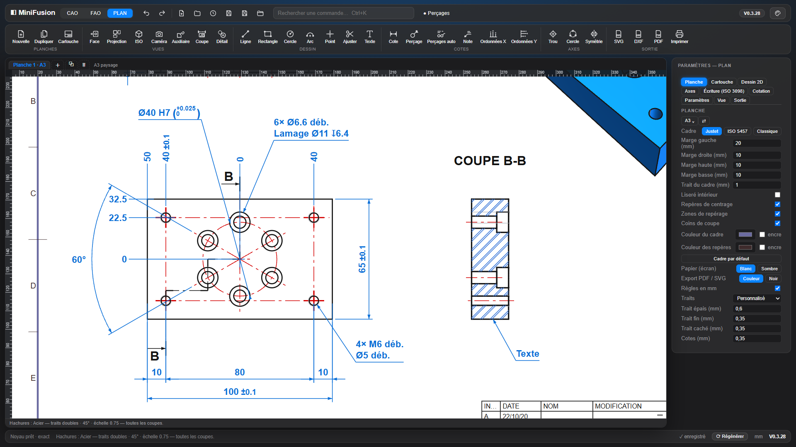

**Dessin 2D** sur la planche : ligne, rectangle, cercle, arc, point, ajustement, texte ; contraintes et accrochage sur les vues.

**Sortie** : SVG, **DXF R12** (calques CONTOUR, CACHE, AXE, COTES, HACHURES, FILETAGE…), **PDF** au format exact de la planche, impression ; en couleur ou tout en noir.

## Souris et clavier

| | Vue 3D | Esquisse |
|---|---|---|
| Clic gauche | sélection | dessin, sélection (jamais de rotation) |
| Glisser gauche | rotation | dessin, déplacement d'entités, sélection au cadre |
| Clic-molette glissé | rotation | **rotation** (orbite autour du centre du dessin) |
| Clic droit glissé | déplacement | **déplacement** |
| Clic droit court | menu contextuel | menu contextuel / annuler l'action |
| Molette | zoom | zoom sous le curseur |
| Flèche bleue (extrusion sélectionnée) | glisser = distance (pas de 1 mm, Maj = libre) ; `Échap` annule la fenêtre | — |
| Clavier | `Ctrl+K` commandes, `Suppr` supprimer une face | `N` à plat, `Échap` fin d'outil, `F1`–`F12`, `H`, `X`, `Ctrl+Z` / `Ctrl+Y` |

## Démarrage

```bat
Server.bat
```

`Server.bat` sert le dossier sur `http://localhost:3000`. N'importe quel serveur statique convient aussi :

```bash
npx serve . -l 3000
```

En `file://` (double-clic sur `fusion_mvp.html`), l'application démarre en mode maillage. Le bouton **Noyau .wasm…** active le noyau exact, qui est ensuite gardé en cache. Des modèles d'exemple se trouvent dans `Exemples/`.

Le dépôt stocke les gros binaires (`occt/*.wasm`, `Exemples/*.miniFusion`, `Exemples/*.step`) via **Git LFS**. Après un clone : `git lfs install` puis `git lfs pull`.

## Scripts et pilotage par Claude (MCP)

- **Script JSON** (menu Projet → 📜) : une liste de commandes exécutées sur le document — `new`, `param`, `sketch` (rectangles, cercles, polygones, lignes sur XY / XZ / YZ, décalés), `extrude`, `revolve`, `config`, `info` (fonctions, paramètres, corps : volume, centre, boîte), `undo`. Le script est **atomique** (défait en entier à la première erreur) et compte pour **une** étape d'annulation.

```json
[{"op":"param","name":"L","expr":"60"},
 {"op":"sketch","id":"s1","plane":"XY","shapes":[{"rect":[0,0,60,40]},{"circle":[30,20,6]}]},
 {"op":"extrude","sketch":"s1","distance":10},
 {"op":"info"}]
```

- **Serveur MCP** `tools/mcp-minifusion.cjs` (Node, sans dépendance) : Claude — ou tout client MCP — envoie des scripts à la page et lit l'état du modèle. Outils : `minifusion_run_script`, `minifusion_info`, `minifusion_commands`. Installation dans Claude Code : `claude mcp add minifusion -- node <chemin>/tools/mcp-minifusion.cjs`. Puis, dans MiniFusion, menu Projet → **🔌 Pilotage (MCP)…** : la page se relie au serveur (WebSocket sur 127.0.0.1:47811, `MINIFUSION_PORT` pour changer ; pages distantes refusées). Recliquer coupe le lien.

## Développement

| Chemin | Rôle |
|---|---|
| `src/*.js` | **Les sources** (76 fichiers, de l'en-tête à l'initialisation ; la FAO est découpée par domaine : parcours, caches, post-processeurs, simulation, interface, ébauche 3D, contour, géodésique, crêtes, perçage). C'est ici qu'on travaille. |
| `fusion_mvp.html` | **Livrable généré** par `node build.js` (le HTML et le CSS de base vivent dans ce fichier, hors de la balise `<script>`). On n'édite jamais le script à la main. |
| `tests/` | Suite Node portable (plus de 100 suites, dont certaines sur le noyau OCCT réel) : `node tests/run.cjs`, en parallèle (`-j N` pour la taille du pool, `--verbose` pour toutes les sorties) ; sous-ensemble rapide : `node tests/run-fast.cjs`. |
| `tests/oracle/` | **Tests de référence** : pièces aux valeurs calculées à la main (volume, surface, centre de gravité, encombrement), vérifiées à chaque version par `test_oracle` ; tableau dans [docs/oracle.md](docs/oracle.md), régénéré par `npm run oracle`. |
| `tools/lint.cjs` | Lint ESLint du script concaténé (même ordre que le build) : `npm run lint` (erreurs) ou `npm run lint:all`. |
| `tools/mcp-minifusion.cjs` | Serveur MCP (stdio) relié à la page par WebSocket local : pilotage de MiniFusion par scripts JSON. |
| `.github/workflows/ci.yml` | CI : build à jour, syntaxe, tests rapides, lint. |
| `CHANGELOG.md` | Une entrée par version : cause, correctif, test. |
| `occt/`, `threejs/` | Noyau OpenCascade WebAssembly, rendu three.js (`.wasm` via Git LFS). |
| `PostPro/` | Une fiche par machine (`siemens-630.js`, `siemens-1520.js`, `fagor-8065.js`) : nom, extension, dialecte, axes, pivotement 3+2 (CYCLE800 ou TRAORI, dégagement avant pivotement), codes M, changement d'outil, fin de programme. Nouvelle machine = copier une fiche, la modifier, `npm run build`. |
| `docs/` | Captures du README, analyses (crêtes constantes), tests de référence (`oracle.md`). |

Cycle de livraison :
1. modifier `src/` ;
2. `node build.js` ;
3. `npm run ci` (build à jour, syntaxe, tests rapides, lint), qui doit être vert ; la suite complète `node tests/run.cjs` quand c'est utile ; `npm run test:browser` pour les parcours critiques dans un vrai Chromium headless (noyau OCCT réel : ouverture d'Axe, esquisse → extrusion, FAO → G-code ; une fois : `npx playwright install chromium`, et `git lfs pull` pour les `.wasm`) ;
4. incrémenter `APP_VER` dans `src/00-entete-et-outils.js` et `version` dans `package.json`, ajouter une entrée au CHANGELOG ;
5. commit, push et tag annoté `V0.x.y`.

**Un seul numéro de version** : `APP_VER` = `package.json` = tag Git.

## Licences

- Code : **ISC** (voir `package.json`).
- `threejs/` : three.js et OrbitControls sous **MIT**, CSG.js.
- `occt/` : OpenCascade Technology sous **LGPL**.
