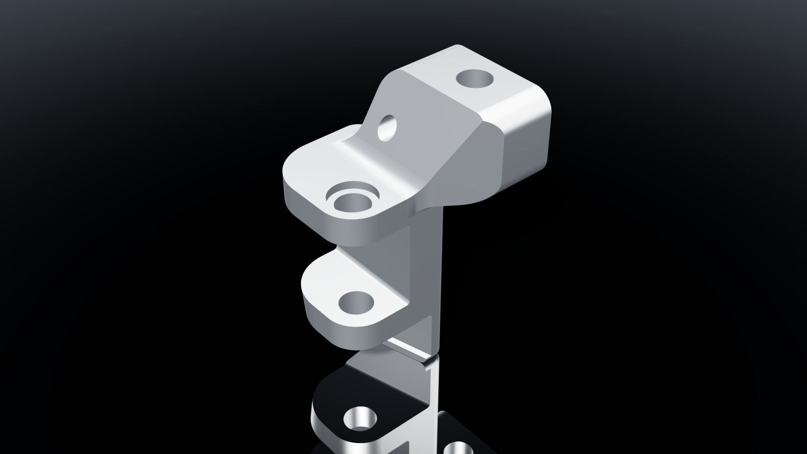
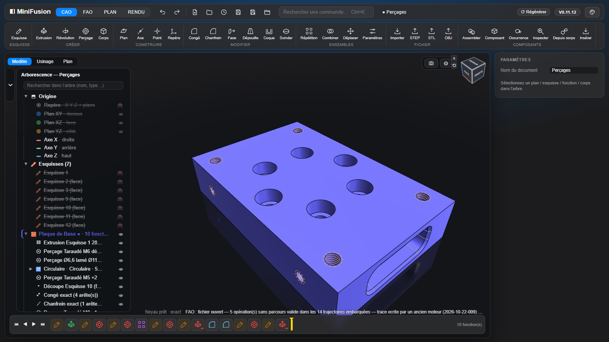
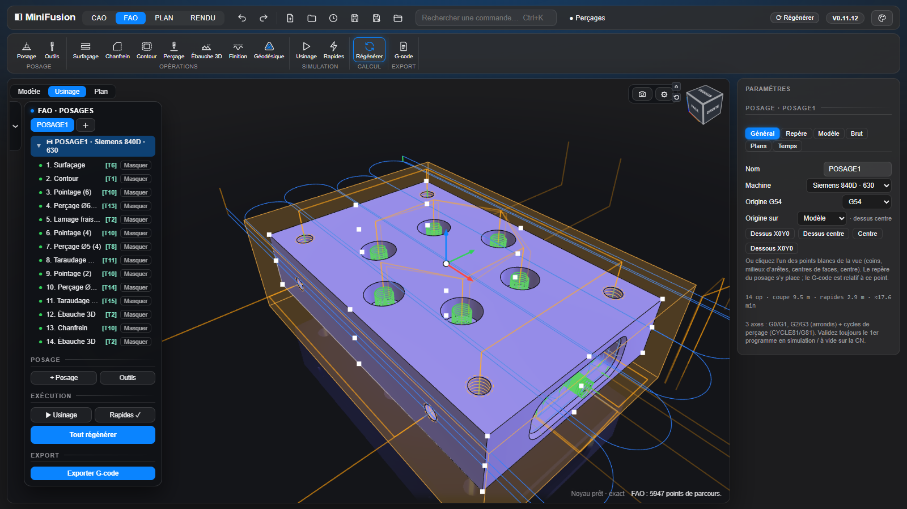
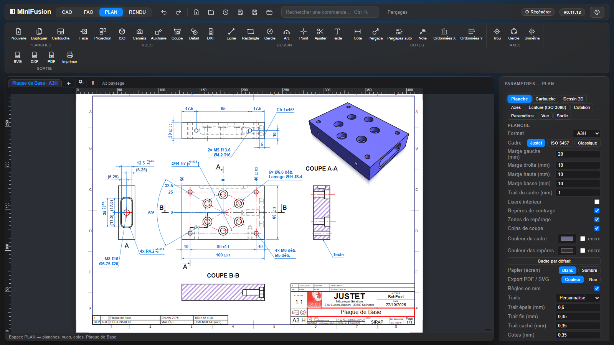
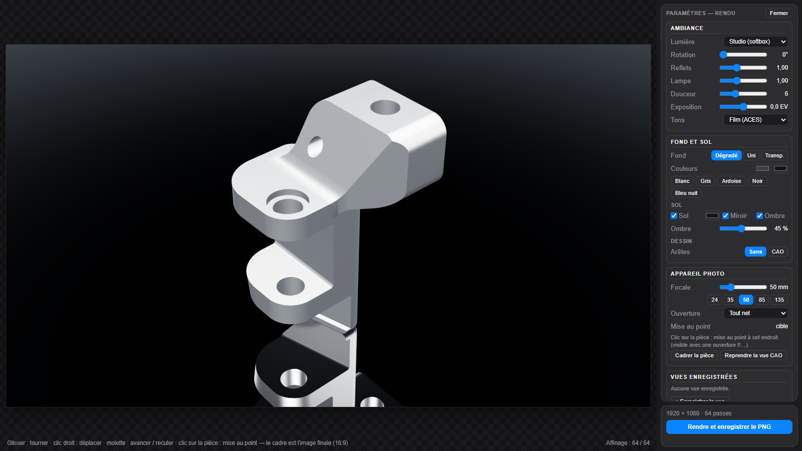
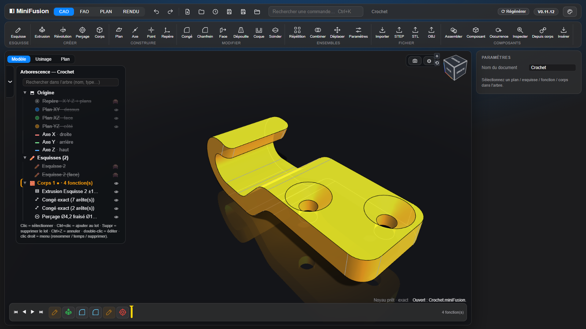
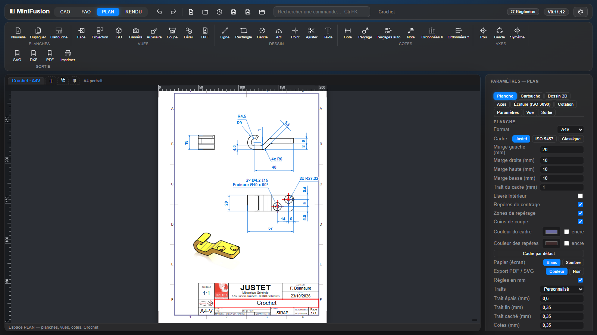

# MiniFusion

**CAO paramétrique, assemblage, FAO, mise en plan et rendu, dans un seul fichier HTML.** On ouvre la page et on travaille : ni installation, ni compte, ni connexion.



Le noyau géométrique exact est **OpenCascade compilé en WebAssembly**. S'il n'est pas disponible, l'application bascule seule sur un moteur maillage (CSG). Version actuelle : **V0.11.12** (voir le [journal des modifications](CHANGELOG.md)).

| | |
|---|---|
|  |  |
| **CAO** : esquisses contraintes, solides à historique, congés exacts, perçages taraudés | **FAO** : posages, 2,5D, 3D, 3+2, perçage, simulation, G-code Siemens et Fagor |
|  |  |
| **PLAN** : planches cotées ISO, coupes, cartouche, nomenclature | **RENDU** : images réalistes 1920×1080 ou 4K |

## Sommaire

- [Interface](#interface)
- [CAO](#cao) : esquisse, construction, fonctions 3D, corps et fichiers
- [Assemblage](#assemblage) : composants, liaisons, références entre composants
- [FAO](#fao) : posage, opérations, perçage, simulation, 3+2, G-code
- [PLAN](#plan) : planches, vues, coupes, cotation, sorties
- [RENDU](#rendu) : ambiances, matériaux, appareil photo
- [Souris et clavier](#souris-et-clavier)
- [Démarrage](#démarrage) · [Scripts et MCP](#scripts-et-pilotage-par-claude-mcp) · [Développement](#développement) · [Licences](#licences)

## Interface

Quatre espaces dans le bandeau supérieur : **CAO**, **FAO**, **PLAN** et **RENDU**.
- **Bandeau** : barre rapide (annuler, rétablir, fichiers), **recherche de commandes** (`Ctrl+K`), état du noyau, **Régénérer**, nom du document (● = non enregistré) et version.
- **Ruban à icônes** propre à chaque espace.
- **Navigateur Modèle / Usinage / Plan** à gauche, avec des **onglets de posages** ; **propriétés** à droite ; **timeline** en bas de la vue 3D.
- **Fenêtres de fonctions** à boutons-icônes, aperçu immédiat, poignées dans la vue, **Annuler / OK**.
- **Annuler / Rétablir partout** (`Ctrl+Z` / `Ctrl+Y`) : CAO, esquisse, assemblage, FAO, PLAN et RENDU.
- **Cinq thèmes** : Nuit, Graphite, Atelier, Clair, Contraste élevé.
- **Vue 3D** : cube de vue, orbite contrainte ou libre, centre de rotation sur la sélection, sol miroir, transparence « verre ».

## CAO



### Esquisse

- **Outils** : ligne, rectangle, oblong, cercle, arc, points de construction et de perçage, **projection associative** d'arêtes (aussi celles des autres composants), **intersection** du plan avec des faces ou un corps, congé, chanfrein, décalage 2D, ajustement.
- **13 contraintes** (horizontal, vertical, parallèle, perpendiculaire, colinéaire, égal, symétrie, tangence, coaxial, milieu, fixe, coïncident, construction) et **cotes pilotées** (longueur, Ø, rayon, distance, angle, entraxe).
- **Solveur** Levenberg-Marquardt au moindre déplacement : une cote impossible est refusée et la barre d'état dit pourquoi ; degrés de liberté réels, esquisse bleue (sous-contrainte) ou blanche (totalement contrainte).
- **Vue d'esquisse** à plat ou dans la vue 3D courante, pièce en transparence, orbite au clic-molette, touche `N` pour revenir à plat.
- **Paramètres nommés**, **expressions ƒx** et **configurations** (tables de variantes).

### Géométrie de construction

Plans (décalé, à un angle, 3 points, médian, normal), axes, points et **repères**, désignés dans la vue ou dans l'arbre. Ils sont **associatifs** : un plan posé sur une face suit la pièce quand une cote change.

### Fonctions 3D

Historique rejouable, timeline à icônes (vert = ajout, rouge = enlèvement), marqueur de temps glissable, réordonnancement par glisser-déposer. Une fonction ne s'appuie que sur ce qui la précède (**règle d'antériorité**).
- **Extrusion** et **révolution** dynamiques : distance, jusqu'à une face, à travers tout, symétrique, dépouille, nouveau corps.
- **Perçage** simple, lamé, fraisé ou **taraudé** (filet ISO réellement modélisé), débouchant ou borgne.
- **Congés et chanfreins exacts** sur la chaîne tangente ou l'arête seule (un clic ajoute ou retire une arête), avec reprise NURBS quand le noyau refuse la chaîne.
- **Répétition** linéaire, en grille, circulaire, symétrie.
- **Modifier** : déplacer ou supprimer une face, dépouille, coque, **scinder** par un plan, **déplacer un corps** (translation, rotation, point à point), **combiner** (union, soustraction, intersection).

### Corps, mesures, fichiers

- **Corps** : matériau (bibliothèque commune avec le RENDU, masse estimée), couleur, transparence, isoler.
- **Mesures** : face à face, Ø, entraxe, entre deux arêtes.
- **Fichiers** : import STEP / STL, export STEP / STL / OBJ, projet **`.miniFusion`** (pièce, FAO, planches, rendu), sauvegarde locale automatique.
- **Enregistrement sûr** : contenu vérifié avant écriture, version précédente gardée (`nom.miniFusion.bak` et copie dans le navigateur).

## Assemblage

Comme dans Fusion 360, **tout est composant** : le fichier est le composant racine, ses enfants sont des pièces complètes, à n'importe quelle profondeur.
- **Arbre unifié** : pièce et composants dans une seule arborescence, avec recherche et glisser-déposer.
- **Modéliser** le composant actif (le reste de l'assemblage affiché autour) ou **Assembler** ses enfants (manipulateur, pas de 1 mm et 5°).
- **Composant**, **Occurrence**, **Insérer** un autre fichier, **Depuis corps** pour convertir une pièce multicorps sans rien remodéliser.
- **Composants liés** à un fichier du dossier de projets : édition sur place, mise à jour, conflits gérés.
- **Aligner** un repère ou un **point d'accroche** (centre et points cardinaux d'une face, axe d'un cylindre, centre d'un cercle) sur un autre composant, de façon associative.
- **Liaisons** : rigide, pivot, glissière, pivot glissant, plan, rotule, avec limites, curseurs et animation.
- **Références entre composants** : faces, arêtes, sommets, plans et axes d'un autre composant servent de références, et suivent ses changements.
- **Inspecter** : propriétés physiques (volume, masse, centre de gravité) et interférences.

## FAO


### Posage

- Le repère du posage est **le repère d'usinage** : origine sur un des **27 points cardinaux** du brut ou du modèle, directions Z / X sur un axe, une face ou une arête, cases « Inverser ».
- **Brut** : boîte, cylindre ou corps réel du modèle ; marges et surépaisseurs.
- **Machine** : Siemens 840D (630 / 1520) ou Fagor 8065, origine G54–G59, plans de dégagement et de retrait.
- **Outils** : fraises cylindriques, boules, toriques, à chanfreiner, forets, forets à pointer et à centrer (DIN 333 A), tarauds.

### Opérations

- **Surfaçage**, **Contour** (côté auto, passes radiales, attaches), **Chanfrein** sur arêtes cliquées.
- **Perçage** : les trous sont **reconnus sur le modèle** (Ø, profondeur, débouchant ou borgne, lamage, filet) et choisis par groupe ; pointage, perçage, débourrage, taraudage, **lamage fraisé en hélice** ; **gamme automatique** pointage → perçage → lamage → taraudage, avec les forets pris dans la bibliothèque ou créés.
- **Ébauche 3D** : niveaux en Z, minipasses, entrées par l'extérieur ou en hélice, spirale « escargot », une région finie avant l'autre.
- **Finition** (passes parallèles ou à crête constante) et **Géodésique** (passes à distance constante depuis les bords des faces).
- **Faces usinables / intouchables** par opération, **zones** (rectangle, chaîne d'arêtes, esquisse, îlots), hauteurs par références.

### Simulation, 3+2 et G-code

- **Simulation** sur la **carte graphique** : outil réel, matière enlevée à partir du vrai brut, rendu réel ou lisse ; moteur **cartes de hauteurs** (une par orientation en 3+2, lancer de rayons) ou **champ de distance**.
- **3+2** : chaque opération peut avoir son propre Z et X ; sur Siemens, le plan de travail pivote par **`CYCLE800`** et les arcs G2/G3 et cycles de perçage sont écrits dans le plan incliné.
- **G-code** multi-outils, cycles du dialecte (CYCLE81 à 84, G81 / G83), avance F modale. *Validez toujours un premier programme à vide sur la machine.*
- **Cache des parcours** : rien n'est recalculé tant que la géométrie ne change pas.

## PLAN



### Planches

- **Formats** A4 à A0, paysage ou portrait, ou format manuel ; plusieurs planches en onglets.
- **Cadre** réglable (préréglages Justet, ISO 5457, Classique), **cartouche** éditable avec logo, **nomenclature** et tableau des révisions.
- **Écriture ISO 3098** et paramètres du plan enregistrés par projet (`.mfplan`).

### Vues

- **Face, projection, ISO, caméra, auxiliaire, coupe et détail**, par corps ou en assemblage (une hachure par pièce, bulles automatiques).
- **Arêtes exactes** du noyau (HLR OCCT), y compris pour un STEP importé ; perspective et cavalière.
- **Ligne de coupe** droite ou brisée (ISO 128-44), **hachures** (ISO 128-50), **filetages** (ISO 6410), **axes** (ISO 128-2).

### Cotation et sorties

- **Cote** unique (longueur, distance, Ø, rayon, angle), **tolérances ISO 286**, cotes associatives qui suivent la pièce.
- **Perçages** cotés depuis la fonction Perçage (« Perçages auto » cote toute la planche), **ordonnées X / Y**, notes à flèche.
- **Dessin 2D** sur la planche avec contraintes.
- **Sorties** : SVG, **DXF R12** par calques, **PDF** au format exact, impression, en couleur ou tout en noir.

## RENDU

Une image soignée de la pièce ou de l'assemblage, en **1920×1080 ou 4K**, enregistrée en PNG. L'atelier a sa propre scène : la vue CAO n'est jamais touchée.
- **Ambiances** générées à la volée (studio, studio lumineux, atelier, extérieur, scène noire) : aucune image externe, l'application reste un seul fichier.
- **Matériaux** de la bibliothèque commune (aciers, aluminiums usinés ou anodisés, laiton, plastiques, élastomères, peintures, bois, verres), **reliefs procéduraux** (brossé, sablé, moleté, bois).
- **Affinage progressif** : ombres douces, bords lisses, **profondeur de champ** ; 16, 64 ou 256 passes pour l'image finale.
- **Appareil photo** : focale en mm, ouverture, mise au point au clic, exposition, rendu des tons ; **vues enregistrées** avec la pièce.
- **Fond et sol** : dégradé, uni ou transparent, sol miroir, ombre réglable.

## Souris et clavier

| | Vue 3D | Esquisse |
|---|---|---|
| Clic gauche | sélection | dessin, sélection |
| Glisser gauche | rotation | dessin, déplacement d'entités, sélection au cadre |
| Clic-molette glissé | rotation | rotation autour du dessin |
| Clic droit glissé | déplacement | déplacement |
| Clic droit court | menu contextuel | menu contextuel / annuler l'action |
| Molette | zoom | zoom sous le curseur |
| Clavier | `Ctrl+K` commandes, `Suppr` supprimer, `Ctrl+Z` / `Ctrl+Y` | `N` à plat, `Échap` fin d'outil, `F1`–`F12` contraintes, `L` `C` `R` `B` `P` `T` `D` `F` `O` outils, `H` perçage, `X` construction, `I` intersection |

## Démarrage

```bat
Server.bat
```

`Server.bat` sert le dossier sur `http://localhost:3000`. N'importe quel serveur statique convient aussi :

```bash
npx serve . -l 3000
```

En `file://` (double-clic sur `fusion_mvp.html`), l'application démarre en mode maillage ; le bouton **Noyau .wasm…** active le noyau exact, gardé ensuite en cache. Des projets d'exemple se trouvent dans `Exemples/` : **Perçages** (plaque usinée complète, avec sa planche), **Crochet**, **Support Pédale Déportée R1200RT 2011**, **Axe**, **Cavité Usinage**, **Malaxeur Retard**…

Le dépôt stocke les gros binaires (`occt/*.wasm`, `Exemples/*.miniFusion`, `Exemples/*.step`) via **Git LFS**. Après un clone : `git lfs install` puis `git lfs pull`.

## Scripts et pilotage par Claude (MCP)

- **Script JSON** (menu Projet → 📜) : `new`, `param`, `sketch`, `extrude`, `revolve`, `config`, `info`, `undo`. Le script est **atomique** et compte pour **une** étape d'annulation.

```json
[{"op":"param","name":"L","expr":"60"},
 {"op":"sketch","id":"s1","plane":"XY","shapes":[{"rect":[0,0,60,40]},{"circle":[30,20,6]}]},
 {"op":"extrude","sketch":"s1","distance":10},
 {"op":"info"}]
```

- **Serveur MCP** `tools/mcp-minifusion.cjs` (Node, sans dépendance) : Claude, ou tout client MCP, envoie des scripts à la page et lit l'état du modèle (`minifusion_run_script`, `minifusion_info`, `minifusion_commands`). Installation : `claude mcp add minifusion -- node <chemin>/tools/mcp-minifusion.cjs`, puis menu Projet → **🔌 Pilotage (MCP)…** dans MiniFusion (WebSocket local 127.0.0.1:47811).

## Développement

| Chemin | Rôle |
|---|---|
| `src/*.js` | **Les sources** : 101 fichiers concaténés dans l'ordre numérique (noyau, esquisse, fonctions 3D, assemblage, FAO découpée par domaine, mise en plan, rendu). C'est ici qu'on travaille. |
| `fusion_mvp.html` | **Livrable généré** par `node build.js`. On n'édite jamais son script à la main. |
| `PostPro/` | Une fiche par machine (`siemens-630.js`, `siemens-1520.js`, `fagor-8065.js`). Nouvelle machine = copier une fiche, la modifier, `npm run build`. |
| `tests/` | 169 suites Node lancées en parallèle (`node tests/run.cjs`), 54 rapides (`node tests/run-fast.cjs`), non-régression des parcours FAO (`npm run parcours`), tests de référence (`tests/oracle/`, [docs/oracle.md](docs/oracle.md)). |
| `tests/browser/` | Playwright dans un vrai Chromium : parcours critiques (`npm run test:browser`) et carte graphique réelle (`npm run test:gpu`). |
| `tools/` | Lint du script concaténé (`npm run lint`), serveur MCP, **captures du README** (`npm run captures`). |
| `occt/`, `threejs/` | Noyau OpenCascade WebAssembly, rendu three.js. |
| `docs/` | Captures du README, analyses, tableaux de référence. |

Cycle de livraison :
1. modifier `src/` ;
2. `node build.js` ;
3. `npm run ci` (build à jour, syntaxe, tests rapides, lint), qui doit être vert ; la suite complète et les tests navigateur quand c'est utile ;
4. incrémenter `APP_VER` (`src/00-entete-et-outils.js`) et `version` (`package.json`), ajouter une entrée au CHANGELOG ;
5. commit, push et tag annoté `V0.x.y`.

**Un seul numéro de version** : `APP_VER` = `package.json` = tag Git.

Les captures de ce README sont refaites par `npm run captures` (Chromium sur la carte graphique, exemples Perçages, Crochet et Support Pédale ; les fichiers ne sont jamais réécrits). `npm run captures -- <dossier> rendu` n'en refait qu'une.

## Licences

- Code : **ISC** (voir `package.json`).
- `threejs/` : three.js et OrbitControls sous **MIT**, CSG.js.
- `occt/` : OpenCascade Technology sous **LGPL**.
