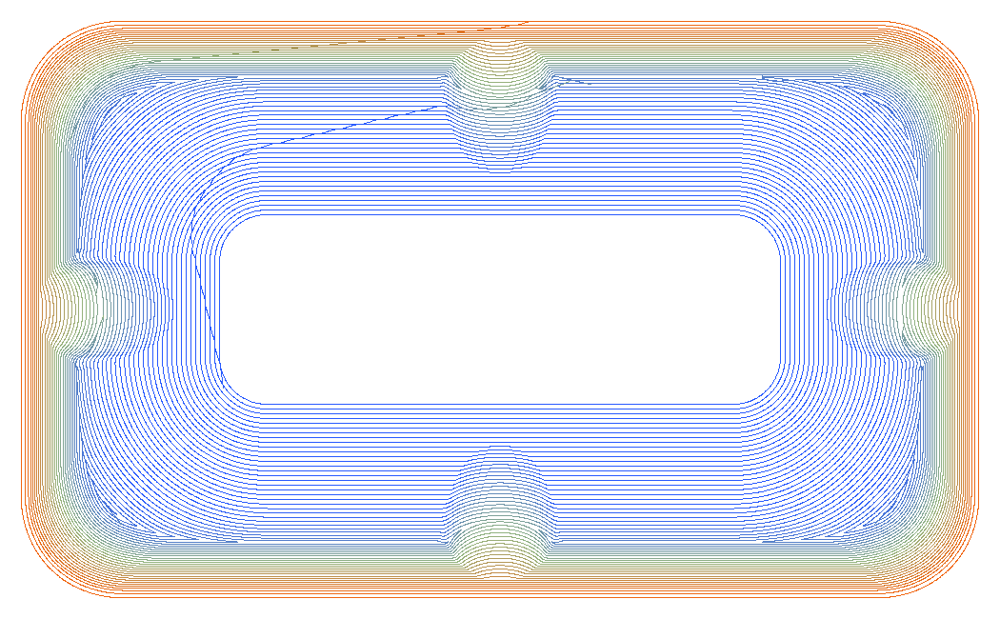
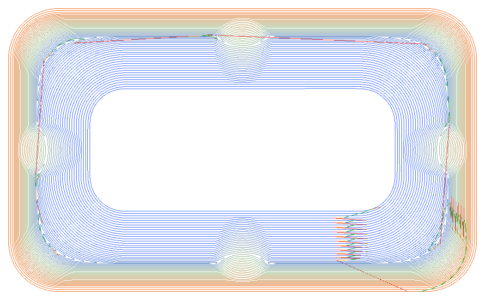
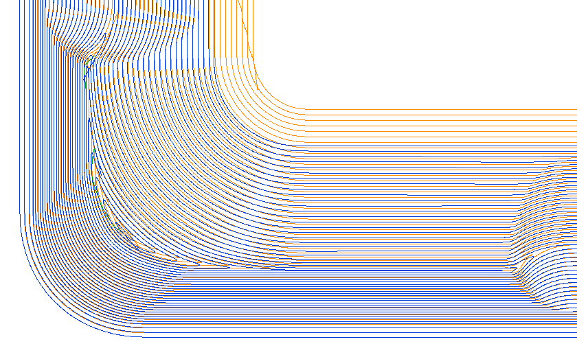
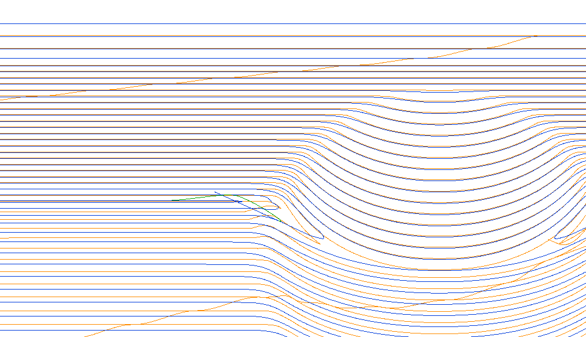
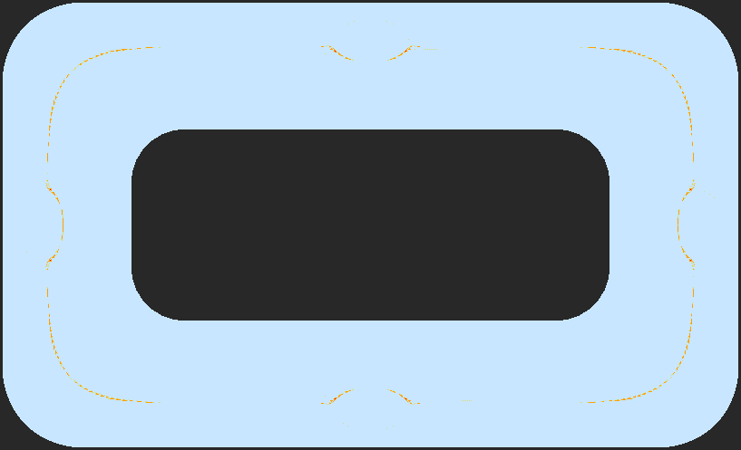
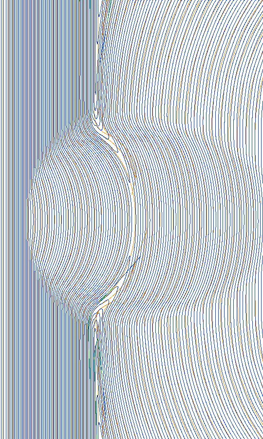

# Crêtes constantes façon Fusion 360

Rétro-ingénierie du parcours « Crêtes constantes » de Fusion 360 et algorithme
retenu dans MiniFusion (`src/89-fao-cretes.js`, trajectoire `op.traj='scallop'`
de l'opération **Crêtes Constantes**, défaut à la création depuis `2026-10-14-001`).

## Données de référence

| Fichier | Rôle |
|---|---|
| `Exemples/cav.txt` | G-code Fagor 8065 produit par Fusion 360 (boule D6, pas 1 mm), 48 636 lignes |
| `Exemples/Cavité Usinage.miniFusion` | le même modèle dans MiniFusion (op « Crêtes Constantes » du posage 1) |
| `fusion360_capture.webp` | capture du parcours dans Fusion 360 |
| `parse.cjs`, `rings.cjs` | lecture du G-code (G0/G1/G2/G3, I/J relatifs) et découpe en anneaux/liaisons |

## Ce que fait Fusion (mesuré dans `cav.txt`)

- **7 blocs** reliés par des rapides (`G0 Z+5` locaux), tout le reste en avance.
- **Bloc 0 : 30 anneaux FERMÉS** partant du bord de l'îlot (fond plat à z −30),
  vers l'extérieur. Sur le plat, le périmètre augmente de 2π par anneau : offsets
  exacts de 1 mm. Tous **horaires**.
- **Bloc 1 : 24 anneaux FERMÉS** partant du bord haut, vers le bas, tous
  **anti-horaires**. En haut de paroi, z = 49,86 → 49,41 → 48,69 → 47,80 … : l'écart
  vaut 1 mm **sur la surface décrite par le centre de l'outil** (et non sur la pièce,
  où l'arrondi du bord ne fait que quelques dixièmes).
- **Blocs 2 à 6 : zones restantes** entre les deux fronts (4 coins, séparés aux
  bosses) remplies de **boucles concentriques en lentille** de plus en plus petites
  (périmètres 240 → 217 → 121 → 86 → 64 → 46 → 28 mm), anti-horaires.
- **Sens** : le côté déjà usiné est toujours à droite du sens d'avance, la
  matière à gauche. En broche M3, c'est de l'avalant. Les anneaux d'un front ne
  changent **pas** de sens de l'un à l'autre.
- **Liaisons** : d'un anneau au suivant, une courbe en S d'environ 4,5 mm
  (≈ 0,75·D) **au contact**, qui se décale d'un pas tout en avançant dans le sens
  de coupe. Les départs successifs dérivent en diagonale (la ligne verte de la
  capture). Entrées et sorties en quart de cercle vertical de rayon ~5 mm.

## Algorithme retenu (refonte `2026-10-14-002`)

Tout se calcule sur la **surface outil** : la cote de la pointe obtenue par descente de l'outil sur une grille XY. On ne part plus de la pièce : la première version convertissait chaque point de contact en position d'outil (contact + normale × R). Dans un creux plus serré que l'outil, cette conversion se **repliait** : passes entassées, puis manque au pied des parois (retour au pas de 0,35). Elle souffrait aussi du bruit des normales du maillage (oscillations) et de l'ambiguïté des arêtes vives.

1. **Grille XY** (maille ~0,7 × pas, au plus 300 000 nœuds dans la zone), Z = descente outil exacte :
   boule (sommets, arêtes, facettes), torique (anneau de 24 boules + disque), fraise droite (disque).
   Région = nœuds dont la **position outil** est dans la zone de l'op (limite ∧ ¬îlot) et dans la fenêtre Z.
2. **Fronts** = composantes connexes du bord de la région, coupé par dichotomie sur les arêtes.
3. **Distance géodésique par front** sur la surface outil, en *Fast Marching* (onde plane par
   triangle). C'est la métrique de Fusion : bord haut 49,86 → 49,41 → 48,69 …
4. **Anneaux** à k·pas, front par front (du plus bas au plus haut), tant que l'iso-ligne est
   faite de boucles **fermées** restant dans le **territoire** du front : les fronts se rencontrent à mi-chemin.
5. **Restes** : d_L = min_k(d_k − couvert_k), iso-ligne **exacte du minimum** dans chaque triangle
   (`faoScIsoMin` : cellules où un seul champ est actif). L'interpolation aux nœuds écrasait le
   pli du minimum : sur une paroi à 65°, la bande de 0,85 mm entre deux fronts ne fait que 0,36 mm
   en XY, et la boucle de reste disparaissait. Les niveaux sont à m·Δ, avec Δ = Mx/(n+½) ≤ pas.
6. **Positions outil** : XY du point d'iso, Z = descente outil exacte (sur une falaise, recul vers
   le bas de la maille), lissage gaussien XY.
7. **Séquences** : groupe par groupe, une boucle n'est disponible que si ses « mères » sont faites ;
   liaison en S au contact vers le niveau suivant, sinon arc de sortie, saut local, arc d'entrée.

## Résultat sur la cavité

Superposition d'un quart (orange = Fusion, bleu = MiniFusion, vert = liaisons) :

Bord haut, à x = 0 (y/z du centre-pointe, en mm) :

| Fusion | 60,60/49,86 | 59,70/49,41 | 59,01/48,69 | 58,55/47,80 | 58,13/46,90 |
|---|---|---|---|---|---|
| MiniFusion | 60,51/49,84 | 59,65/49,37 | 59,01/48,69 | 58,51/47,71 | 58,09/46,81 |

- 2 fronts, 24 + 24 anneaux, 32 boucles de reste ; environ 1,1 s en Node au pas de 1, 5,5 s au pas de 0,35.

### Pas fin (0,35) : couverture

Carte de couverture : gris = hors zone, bleu clair = passe à ≤ 0,525 mm (moitié du pas + 5 %),
jaune = jusqu'à 0,75 pas, orange = jusqu'à 1,5 pas, rouge = au-delà. Il ne reste que des
traits fins au centre des lentilles (écart ≤ 1,5 pas, limite du remplissage par niveaux) :
0,27 % des points au-delà de 0,75 pas, 0 % au-delà de 1,5 pas (contre 0,72 % et 0,11 % avec
la première version, concentrés au pied des parois).

Bosse gauche au pas de 0,35 (bleu = MiniFusion, orange = Fusion au pas de 1) : passes régulières, sans oscillation.

- **Différence connue** : dans le document MiniFusion, l'îlot de l'op (esquisse 66 × 26,5,
  marge −5, garde D/2) exclut |x| < 64. Fusion part de 58,9 parce que son îlot est réglé
  autrement. C'est un réglage de l'opération, pas l'algorithme.

Tests : `tests/test_fao_cretes.cjs` (cuvette synthétique, outils, FMM, descente outil,
op, cavité réelle `tests/fixtures/cavite_usinage_mesh.json`).
